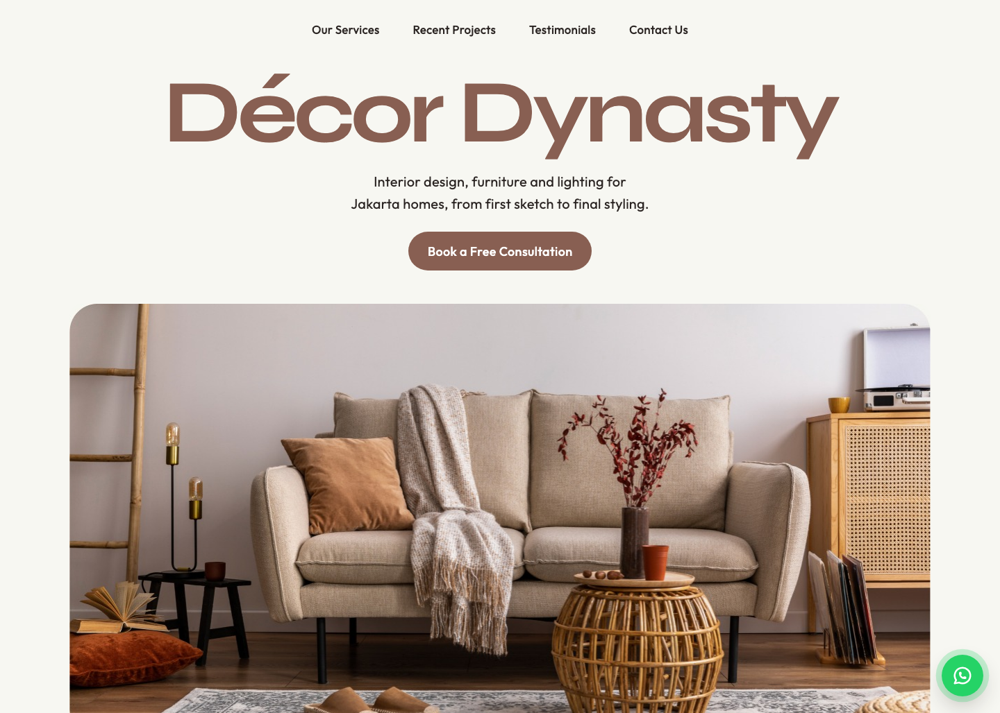

# Décor Dynasty

Landing page for **Décor Dynasty** — interior design, furniture and lighting for Jakarta homes.

| Desktop 1440 × 1028 | iPhone 17 Pro (402 × 874) |
| --- | --- |
|  |  |

## What's inside

| Folder | What |
| --- | --- |
| [`web/`](web/) | Responsive website — PHP partials, Tailwind CSS, vanilla JS (320px → 1440px+) |
| [`docs/`](docs/) | Tech notes, WCAG 2.2 AA report, responsive screenshots |

A React Native app (`mobile/`) can be added alongside `web/` later; it should reuse the same tokens (see `web/tailwind.config.js`).

## Quick start (web)

```bash
cd web
npm install
npm run build
php -S localhost:8000 -t public
```

Open <http://localhost:8000>. Details: [web/README.md](web/README.md).

## Docs

- [Tech — Web](docs/TECH-web.md): stack, breakpoints, structure, deployment, differences from the source HTML
- [WCAG 2.2 AA — Code test · Web](docs/WCAG-web.md)
- [Screenshots](docs/screenshots/)

## Licence

Code: MIT. Fonts: SIL OFL 1.1. Photos: project content. See [LICENSE](LICENSE).
